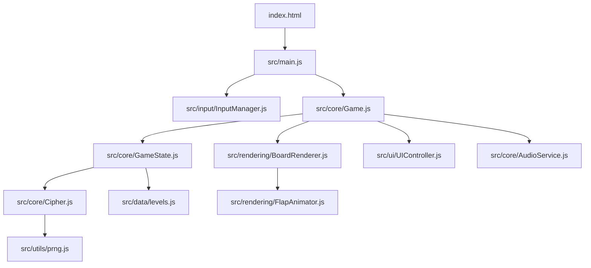

# Half-Flap Cryptogram: Architecture Guide

## 1. Background & Architecture Problems Addressed
Prior to this refactor, the entire application resided inside a single monolithic `index.html` file (>1,000 lines). This monolithic pattern presented several scalability bottlenecks:
- **Tightly Coupled Presentation & Game Rules**: DOM manipulation and animation timers were intermixed with cipher permutations and win condition logic.
- **Global Mutable State**: Global arrays and objects (`drums`, `cells`, `groups`, `lockedPreviously`, `bothFlapsLinked`) were modified arbitrarily by event listeners.
- **Difficult Extensibility**: Adding new mechanics (like custom hint types, timers, or level selectors) required hunting through a single giant script block.
- **Lack of Modern Tooling**: No ES module tree-shaking, automated bundling, or minification for production distribution.

---

## 2. Target Architecture
The application now follows a **modular, layered ES6 architecture** built on top of **Vite**:

```text
E:\PROTO\Splitflap\
├── index.html                  # Lightweight HTML document root & module entry link
├── package.json                # NPM configuration, dependencies & build scripts
├── vite.config.js              # Vite bundler configuration (relative base path './')
│
├── src/
│   ├── main.js                 # Application bootstrapper and dependency wiring
│   │
│   ├── config/
│   │   └── constants.js        # Immutable constants, audio parameters, animation timings
│   │
│   ├── data/
│   │   └── levels.js           # Data-driven level definitions
│   │
│   ├── core/
│   │   ├── Game.js             # High-level coordinator (Lifecycle & Event Dispatcher)
│   │   ├── GameState.js        # Pure state store, validation, and transition logic
│   │   ├── Cipher.js           # Deterministic substitution cipher permutation generator
│   │   └── AudioService.js     # Web Audio API physical clicks, chimes, and fanfare
│   │
│   ├── rendering/
│   │   ├── BoardRenderer.js    # DOM factory for words, cells, and fixed punctuation
│   │   └── FlapAnimator.js     # 3D keyframe animations via Web Animations API
│   │
│   ├── input/
│   │   └── InputManager.js     # Centralized keyboard and button event listener
│   │
│   ├── ui/
│   │   └── UIController.js     # HUD state management (Badges, Status, Button toggles)
│   │
│   └── utils/
│       ├── dom.js              # DOM selector utilities
│       └── prng.js             # Deterministic seedable LCG / XorShift PRNG
│
├── styles/
│   ├── main.css                # Base theme variables, layout, typography, header
│   ├── board.css               # Board container, word layout, author row, tags
│   ├── flaps.css               # 3D split-flap perspective, seams, fixed tiles, lock/clash highlights
│   └── controls.css            # Drum groups, action buttons, instructions card
│
└── docs/
    ├── ARCHITECTURE.md         # This architecture manual
    └── REFACTOR_MIGRATION.md   # Refactor migration decisions & validation report
```

---

## 3. Folder & Module Responsibilities

| Module | Primary Responsibility |
| :--- | :--- |
| `src/main.js` | Instantiates services, wires dependencies together, and initiates the game. |
| `src/config/constants.js` | Houses immutable definitions: alphabet order, audio constants, animation durations. |
| `src/data/levels.js` | Pure data array containing quote texts, author names, difficulty scores, and clue counts. |
| `src/core/GameState.js` | Maintains current puzzle state, validation, drum data, clue tracking, and win conditions. |
| `src/core/Cipher.js` | Pure cipher math: generates deterministic derangements ($C \neq P$). |
| `src/core/AudioService.js` | Synthesizes click transients, letter-lock chimes, and victory fanfare via Web Audio API. |
| `src/core/Game.js` | Orchestrates state transitions, triggers rendering updates, and coordinates audio. |
| `src/rendering/BoardRenderer.js` | Constructs the physical DOM structure and manages cell CSS state classes. |
| `src/rendering/FlapAnimator.js` | Executes 3D split-flap rotation keyframes with precise stagger timing. |
| `src/input/InputManager.js` | Normalizes keyboard shortcuts and button clicks, dispatching actions to `Game`. |
| `src/ui/UIController.js` | Updates HUD elements: Level Badge, Letter Count Badge, Status Bar, Button states. |
| `src/utils/prng.js` | Seedable deterministic PRNG ensuring reproducible cipher seeds per level. |

---

## 4. Dependency Flow & Separation of Concerns



### Architectural Principles:
1. **Unidirectional Control Flow**: User input goes exclusively through `InputManager` $\rightarrow$ `Game` $\rightarrow$ `GameState` $\rightarrow$ `BoardRenderer` / `UIController` / `AudioService`.
2. **Pure Domain Logic**: `GameState` and `Cipher` contain zero DOM references, allowing them to be unit-tested in isolation or ported to canvas/WebAssembly.
3. **Decoupled Audio**: Audio playback is isolated in `AudioService` and triggered via callbacks or explicit service calls.

---

## 5. Game-State Ownership
- `GameState` is the **single source of truth** for puzzle data:
  - `drums`: `{ [cipherChar]: { t: string, b: string, sol: string, fx: { t?: boolean, b?: boolean } } }`
  - `groups`: List of unique cipher characters in current puzzle.
  - `hintsRemaining`: Remaining hint allowance.
  - `bothFlapsLinked`: Boolean flag for synchronized drum rotation.
  - `isWon`: Boolean state.
- `BoardRenderer` only mirrors the state in the DOM and never mutates game data directly.

---

## 6. Level-Data Architecture
Levels are fully data-driven. Adding a new quote does not require writing game engine logic.

```javascript
// Example entry in src/data/levels.js
{
  quote: "Be the change that you wish to see in the world.",
  author: "Mahatma Gandhi",
  diff: "73.5",
  given: 6
}
```

The engine automatically:
1. Derives the cipher substitution map.
2. Extracts word tokens and separates fixed punctuation.
3. Appends the guessable author row.
4. Distributes starting fixed clues based on `given`.
5. Updates level and letter progress HUD counters.

---

## 7. How to Add a New Level
1. Open `src/data/levels.js`.
2. Add a new object to `LEVEL_DATA`:
   ```javascript
   {
     quote: "YOUR NEW QUOTE HERE WITH PUNCTUATION.",
     author: "AUTHOR NAME",
     diff: "XX.X",
     given: 6
   }
   ```
3. Save the file. The level is automatically integrated and playable in the level cycle.

---

## 8. How to Add a New Gameplay System (e.g. Timer or Score Tracker)
1. **State**: Add necessary fields (e.g. `elapsedSeconds`) to `src/core/GameState.js`.
2. **Logic**: Add time tracking methods in a new service or within `src/core/Game.js`.
3. **UI**: Add display elements in `index.html` and update methods in `src/ui/UIController.js`.
4. **Style**: Add styling in `styles/controls.css` or `styles/main.css`.

---

## 9. Build & Deployment Commands

```bash
# Start local development server (with HMR)
npm run dev

# Build optimized production bundle to dist/
npm run build

# Preview production build locally
npm run preview
```

### Deployment:
The build output in `dist/` uses relative asset URLs (`base: './'`), making it compatible with:
- Static hosting (Netlify, Vercel, Cloudflare Pages)
- GitHub Pages (subdirectories)
- Local file preview (`file://` or static web servers)
- Native wrappers (Capacitor, Cordova, Electron)
