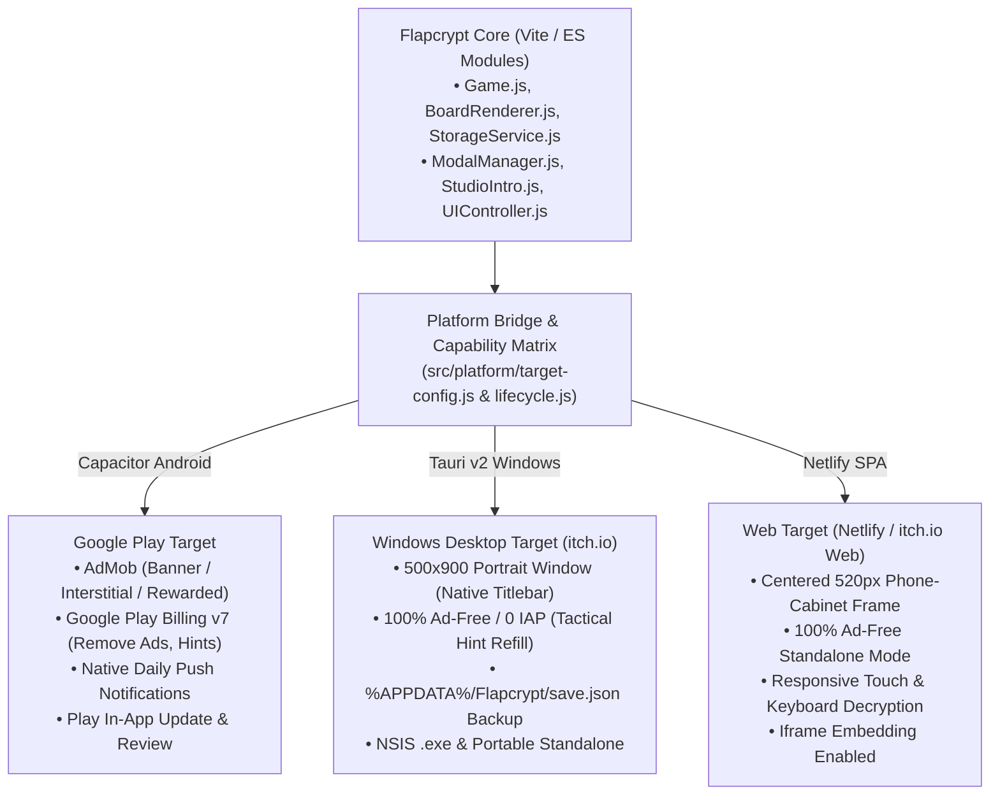

# Multi-Platform Architecture Specification: Flapcrypt

Targeting **Google Play Store** (Capacitor Android), **Desktop Windows .exe** (Tauri v2 for itch.io / standalone), and **Web** (Netlify / web portals) from a unified, modular Vite and ES-module codebase.

---

## 1. System Architecture



---

## 2. Capabilities Matrix

The runtime platform is resolved dynamically via `TargetConfig.capabilities`:

| Capability | Android (`playstore`) | Desktop (`desktop`) | Web (`web` / `itch`) |
|---|:---:|:---:|:---:|
| `hasAds` | ✅ Yes (AdMob) | ❌ No (100% Ad-Free) | ❌ No (100% Ad-Free) |
| `hasIAP` | ✅ Yes (Play Billing) | ❌ No (0 Paywalls) | ❌ No (0 Paywalls) |
| `hasLocalNotifications` | ✅ Yes (Native Alarms) | ❌ No | ❌ No |
| `hasInAppReview` | ✅ Yes (Play In-App) | ❌ No (URL link) | ❌ No (URL link) |
| `hasInAppUpdate` | ✅ Yes (Play In-App) | ❌ No (itch.io page) | ❌ No (auto-reloads) |
| `hasDesktopStorage` | ❌ No (Android sandbox) | ✅ Yes (%APPDATA% Mirror) | ❌ No (localStorage) |
| `isStandaloneMode` | ❌ No | ✅ Yes | ✅ Yes |

---

## 3. Platform Implementations

### Android (Google Play Store)
- Built via `@capacitor/android` and Vite `--mode playstore`.
- Assets synced into `android/app/src/main/assets/public`.
- Banner ad docked at bottom, interstitial on level completion, rewarded video for free hints.
- Google Play Billing allows purchasing Remove Ads, 25 Hints, and 50 Hints.

### Windows Desktop (Tauri v2)
- Built via Tauri v2 (`src-tauri/`) and Vite `--mode desktop`.
- Standalone NSIS installer (`.exe`) and portable standalone for itch.io.
- Portrait `500 × 900 px` native Windows frame with standard minimize, maximize, and close controls.
- Automatic `%APPDATA%/Flapcrypt/save.json` backup syncing on every `StorageService.save()`.
- Hint economy operates on Daily Free Hint + 60s Tactical Hint Refill (no ads or paid microtransactions).

### Web (Netlify & itch.io Web)
- Built via Vite `--mode web` into `dist/web/`.
- Configured via `netlify.toml` for Single Page Application rewrite rules.
- Frame-ancestor headers allow embedding in itch.io iframes.
- Responsive container automatically centers the game at `520px` max-width with dark pine blueprint vignette backdrop on wide monitors.

---

## 4. Build Commands

```bash
# Web distribution (Netlify)
npm run build:web

# Desktop web bundle (Tauri frontend)
npm run build:desktop

# Tauri desktop development
npm run tauri:dev

# Tauri desktop packaging (NSIS .exe & standalone)
npm run tauri:build

# Android Play Store sync & build
npm run build:playstore
npm run build:apk
npm run build:bundle
```
